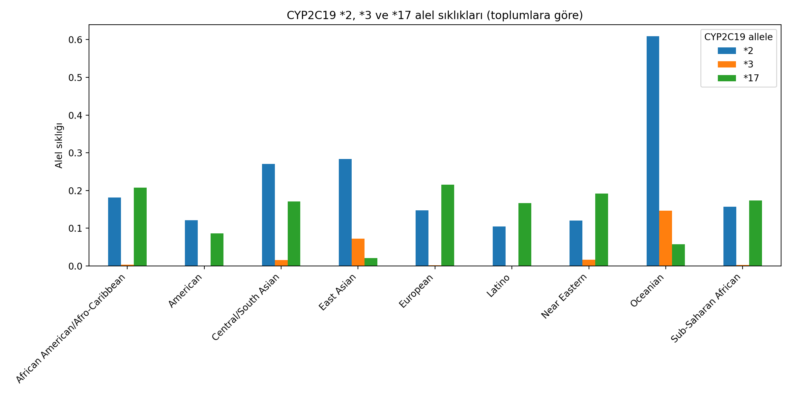
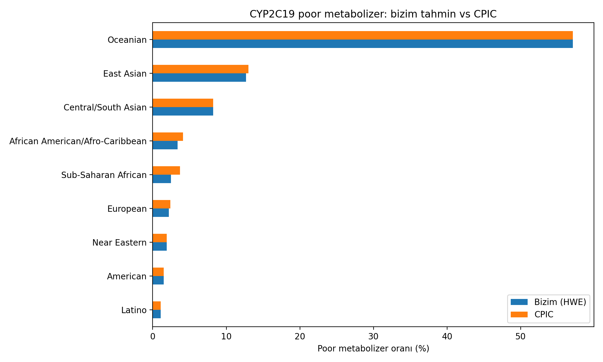

# CYP2C19 Population Allele Frequencies and Estimated Poor Metabolizer Rates

## Question
How do CYP2C19 no-function (*2, *3) and increased-function (*17) allele
frequencies differ across biogeographical groups, and how does this affect
the expected proportion of poor metabolizers (relevant for clopidogrel)?

## Data
CPIC CYP2C19 frequency table (Allele frequency and Phenotype frequency sheets),
accessed via ClinPGx on 25 Oct 2026. The data file is not redistributed here;
please download it from cpicpgx.org and cite CPIC.

## Method
1. Loaded allele frequencies into pandas.
2. Plotted *2, *3 and *17 frequencies per biogeographical group.
3. Estimated the poor metabolizer rate as (f*2 + f*3)^2 under Hardy-Weinberg
   equilibrium.
4. Compared my estimate with CPIC's reported Poor Metabolizer frequencies.

## Results
- No-function alleles (*2, *3) are most frequent in East Asian and
  Central/South Asian groups; *17 is more frequent in European,
  African American and Near Eastern groups.
- My simple estimate closely matched CPIC's values for most groups
  (see pm_karsilastirma.csv).
- The largest difference between my estimate and CPIC was in Sub-Saharan African (1.2 percentage points: 2.5% vs 3.7%). Estimates were identical for five of nine groups.
 - In all groups with a difference, CPIC's estimate was higher than mine, which may reflect additional no-function alleles counted by CPIC.

## Limitations
- Only *2 and *3 are counted; other rare no-function alleles are ignored.
- Hardy-Weinberg equilibrium is assumed.
- Biogeographical groups are broad, and small sample sizes (e.g. Oceanian)
  may limit reliability.
- Turkish population data are not included.
- Educational analysis; not for clinical decision-making.

## Tools
Python, pandas, matplotlib (Google Colab)
